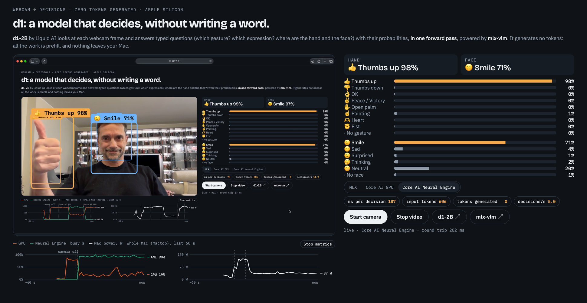

# d1 gestures

Your webcam in, hand gesture and facial expression out, live, on a Mac.



[d1-2B](https://huggingface.co/LiquidAI/d1-2B) by Liquid AI is a decision model, not a chat model. Each webcam frame gets four typed questions (which gesture? which expression? where is the hand? where is the face?), and one forward pass answers all of them with calibrated probabilities. It generates **0 tokens**: all the work is prefill. On an M5 Max that is about 70 ms and ~600 input tokens per frame, roughly 14 decisions a second. It runs through [mlx-vlm](https://github.com/Blaizzy/mlx-vlm).

Everything stays on your Mac: the page and the model are served from `127.0.0.1`, and no frame is uploaded anywhere.

## Run it

Requires Apple Silicon and [uv](https://docs.astral.sh/uv/).

```bash
./start.sh
```

It starts `decide.py` and opens <http://127.0.0.1:8049> once the model is ready (Ctrl-C stops it). Press **Start camera** and allow it. The first run downloads the model (2.2 GB). Prefer it by hand? `uv run decide.py`, then open the page.

Try thumbs up, thumbs down, OK, peace, open palm, pointing, a fist. Then smile, look sad or surprised, or keep a neutral face. Hold each one still for a second, close to the camera.

## How it works

1. The browser draws each webcam frame onto a canvas and posts it as a 640 px JPEG to `POST /run`. The next frame is sent only after the answer for this one comes back.
2. `decide.py` passes the frame and the active questions to `model.system_one(...)`, which runs one forward pass on the GPU.
3. The page draws one tile and the probabilities as bars per question, plus the boxes on the mirrored video. Tap a tile to hide it and its box.

### Your own questions

Open **Questions** on the page to ask d1 something else, on the camera or a video file: pick a preset (*Gestures & face*, the default; *People & objects*; *Counting*; *At the desk*) or build your own, then press **Ask these**. Each question has a name, a type and the question itself:

| Type | Answers | Core AI answer slots |
| --- | --- | --- |
| Yes / No (`noul`) | the probability of yes | 1 |
| Choice | one of its options (a key and what it looks like), with every option's probability | 1 |
| Score | one of 2 to 10 levels, lowest first | 1 |
| Number | a count or an amount in a range ("How many free tables are in the image?", 0 to 20, step 1), with a 10–90% interval | 1 |
| Box | where the thing is, and whether it is there | 5 |
| Boxes | every one of them, up to a max: where, and how many | 5 per box (default 3) |

A box named `X_box` goes with the question `X`: one tile, and the box is labelled with `X`'s answer, as the hand and face are by default. The set is kept in your browser, and **copy link** gives a link that opens the page with it. Up to 12 questions; `POST /questions` with `{"questions": {...}}` does the same without the page, and `GET /questions` returns the active set. The Core AI backends answer any set that fits their export (see below): the panel shows how much of it a set uses, and a set too big for it runs on MLX only. The default questions are `QUESTIONS` in `decide.py`.

| Variable | Default |
| --- | --- |
| `DECIDE_PORT` | `8049` |
| `DECIDE_MODEL` | `LiquidAI/d1-2B-MLX-8bit` |

## Core AI: the same model on the GPU or the Neural Engine (optional, macOS 27)

The page has a three-way selector: **MLX** (the default), **Core AI GPU** and **Core AI Neural Engine**. The two Core AI backends run d1-2B exported from the PyTorch weights to Core AI as one fixed-shape function: the 640×360 frame and the prompt for `QUESTIONS` in, the answer logits out. The questions are an input, not part of the model. A small Swift worker runs it; `decide.py` starts it on first use and keeps it warm. `POST /run?backend=mlx|coreai-gpu|coreai-ane` picks the backend per request, and `GET /status` says which are available. Without the worker below, MLX works as before, and the Core AI buttons are disabled with the reason.

The two models are on Hugging Face, [ivanfioravanti/d1-2B-gestures-CoreAI](https://huggingface.co/ivanfioravanti/d1-2B-gestures-CoreAI) (LFM Open License v1.0, converted from [LiquidAI/d1-2B](https://huggingface.co/LiquidAI/d1-2B)). `decide.py` downloads each one the first time you select it (3.1 GB each, then cached), plus d1's input embedding table (500 MB), which it needs to build the prompt. All you build is the worker (Xcode 27):

```bash
cd coreai/swift && swift build -c release
```

To export the models yourself instead (uv, and a checkout of [apple/coreai-models](https://github.com/apple/coreai-models) at `~/github/coreai-models`), then run with `D1_COREAI_DIR=coreai/out`:

```bash
cd coreai && mkdir -p out
uv venv -p 3.12 .venv
uv pip install -p .venv/bin/python "coreai-core==1.0.0b2" "coreai-torch==0.4.2" "torch==2.9.0" "transformers>=5.19,<6" "mlx-vlm==0.7.12" safetensors pillow numpy accelerate
uv pip install -p .venv/bin/python --no-deps ~/github/coreai-models/python
hf download LiquidAI/d1-2B                       # the PyTorch weights, 3.8 GB
.venv/bin/python check_torch.py                  # writes prompt.json and checks the PyTorch port against MLX
.venv/bin/python export_gpu.py                   # out/d1_gpu_prompt_fp16.aimodel (3.1 GB)
.venv/bin/python export_ane.py                   # out/d1_ane_prompt_fp16.aimodel (3.1 GB, Neural Engine layout)
.venv/bin/python parity.py out/d1_gpu_prompt_fp16.aimodel:gpu out/d1_ane_prompt_fp16.aimodel:ane   # optional: the parity table
```

The questions are not baked into the export. `decide.py` builds the prompt for the active questions when they are set (at start, `QUESTIONS`; then whatever the page asks), and the Core AI workers restart with it in a second or two, on the same models. The export is padded to fixed sizes: up to 640 tokens of prompt (the image is 220 of them; today's questions use 578), 16 answer positions (a choice takes 1, a box 5) and 1152 readout tokens. Questions that don't fit make the Core AI backends refuse with the sizes (the page disables them and says why), and MLX still works. `export_gpu.py` / `export_ane.py` trace the function with the prompt from `coreai/questions.py`, which only sets the shapes. The Core AI export is traced at one shape, 16:9 (640×360, what the page sends from a 16:9 webcam). Core AI centre-crops other frame shapes, such as a 4:3 webcam or a square photo, to 16:9 before the model sees them. Its boxes are mapped back onto the whole frame, but anything outside the crop is invisible to it: a face cut by the crop gets a box that stops at the crop's edge. MLX takes every shape as it is.

Measured on an M5 Max (macOS 27.3) with the same frame. Each decision is timed from the picture to the answers (preprocessing, model, readout), median of 30 after 5 warm-ups. Model time is measured inside the Swift worker:

| | MLX 8-bit | Core AI GPU (fp16) | Core AI Neural Engine (fp16) |
| --- | --- | --- | --- |
| per decision | 59 ms | 55 ms | 182 ms |
| model time only | | 43 ms | 171 ms |
| first start ever (specialization) | | 12 s | **56 s** |
| start when cached | | 0.6 s | 0.3 s |
| size | 2.1 GB | 3.1 GB | 3.1 GB |
| matches MLX on 9 test frames | reference | 9 / 9 | 8 / 9 |

The Neural Engine build runs the whole graph on the Neural Engine. Its compiled plan is marked `mps.fullyPlacedOnANE` and `mps.noGPUActivity`. It is about 3× slower than the GPU for this 2B model but draws far less power: about 3.2 J per decision against 6.0 J for Core AI GPU and 8.4 J for MLX (whole Mac, above idle). Each MLP is computed in 8 chunks of its hidden channels, which made the Neural Engine 1.4× faster (from 236 to 171 ms); int8 weights did not help it. The first switch to it compiles for the Neural Engine, which takes about a minute once, and the request waits. After that, Core AI's cache makes it start in under a second. Its one miss on the test frames is a uniform mid-gray frame: same answers, but a probability off by 0.051, against the 0.05 tolerance. Every real frame matches. To match the GPU's numbers, the Neural Engine export needed exact rescalings of its weights: the Neural Engine loses precision on very small activations and its sigmoid is coarse. The [model card](https://huggingface.co/ivanfioravanti/d1-2B-gestures-CoreAI) lists every change. Int8 weights halve the size, but they bring no speedup on the GPU and don't keep parity on the Neural Engine, so they are not used.

With [mactop](https://github.com/metaspartan/mactop) installed (`brew install mactop`), two charts under the video show the last 60 s of the Mac's CPU, GPU and Neural Engine load and its power draw, one sample a second, camera on or off, with a mark at each backend switch. **Stop metrics** pauses them, and `decide.py` stops mactop a few seconds later. The figures cover the whole Mac, not just d1: macOS camera effects such as backgrounds also run on the Neural Engine, so turn them off in Control Center → Video Effects before comparing backends. Even with them off, an open camera keeps macOS camera processing busy on the Neural Engine, so for a clean comparison press **Load video** and pick a local movie instead: the page plays it (it never leaves the browser, only its frames go to `decide.py`) and the camera stays closed. On an M5 Max the Neural Engine runs at 100% busy and about 35 W for the whole Mac, while either GPU backend draws about 130 W.

## Limits

The model looks at one still frame at a time, so it sees poses, not movements: a wave or a nod would need a short clip. Subtle expressions are harder to read, so exaggerate them.
